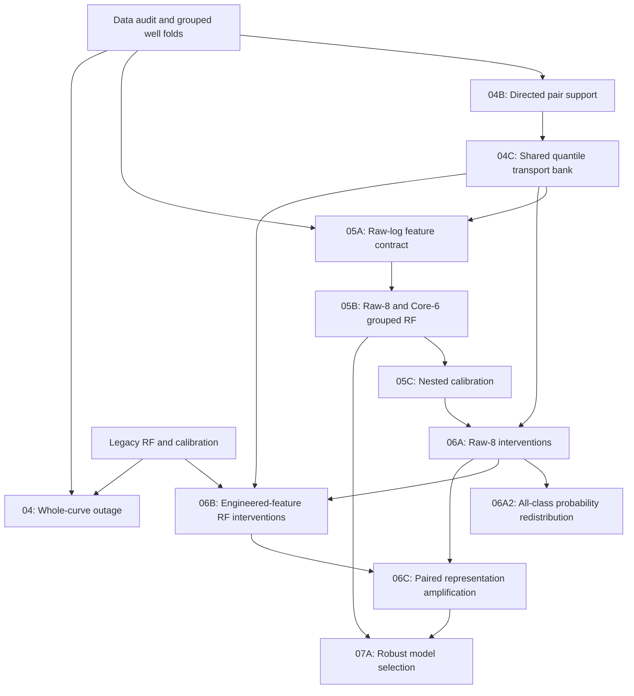

# StrataShift

**Controlled Measurement Interventions, Representation Sensitivity & Robustness for Lithology Classifiers**

*A well-aware research framework for testing how lithology classifiers respond to controlled changes in their well-log inputs, from intervention design and calibrated baselines to paired model-response analysis and robustness selection.*

StrataShift uses the FORCE 2020 well-log/lithofacies dataset as a case study and focuses on **intervention design, evaluation, and model diagnostics**.

## Contents

- [Motivation](#motivation)
- [Research questions](#research-questions)
- [Pipeline overview](#pipeline-overview)
- [Repository layout](#repository-layout)
- [Notebook guide](#notebook-guide)
- [Key results](#key-results)
- [Quick start](#quick-start)
- [Evaluation principles](#evaluation-principles)
- [Future work](#future-work)
- [Data and attribution](#data-and-attribution)

## Motivation

Lithology classifiers rely on correlated well logs and engineered features. High accuracy alone does not show:

- how **robust** predictions are when a measurement is missing or shifted,
- which perturbations are **supported by the available data**, and
- whether the model's **confidence scores are reliable**.

StrataShift addresses these questions with a traceable sequence of data audits, intervention specifications, baselines, and calibration checks.

## Research questions

1. **Outage sensitivity:** How does a trained model respond when an entire well log becomes unavailable?
2. **Feasible interventions:** Which transitions between lithology-conditioned measurement distributions have sufficient data support?
3. **Comparable interventions:** Can a shared intervention bank apply identical perturbations to different classifiers?
4. **Raw vs. engineered features:** How do raw-log and engineered-feature models differ in their sensitivity to the same interventions?
5. **Probability reliability:** Can nested, well-grouped calibration improve probabilistic predictions without information leakage?

Interventions are applied to the **measurement inputs** of the models and are designed as synthetic distributional shifts for model diagnostics.

## Pipeline overview

| Stage | Purpose |
|---|---|
| **04 · Whole-curve outage** | Measures how a frozen Random Forest responds when an entire log is removed, with negative controls |
| **04B · Pair support registry** | Checks data support for every directed source → target lithology transition per feature and fold |
| **04C · Shared transport bank** | Builds quantile-transport interventions at four intensity levels |
| **05A · Raw-feature contract** | Defines the raw-log feature set and training-only preprocessing rules |
| **05B · Raw-log Random Forest** | Trains Raw-8 and Core-6 models under unseen-well grouped cross-validation |
| **05C · Nested calibration** | Applies leakage-free, well-grouped temperature calibration |
| **06A · Raw-8 interventions** | Evaluates intervention effects on frozen raw-log models |
| **06A2 · All-class redistribution** | Tracks how probability shifts across all 12 lithology classes |
| **06B · Engineered-feature interventions** | Applies the same interventions to a frozen engineered-feature model |
| **06C · Paired amplification** | Compares intervention effects between raw and engineered representations |
| **07A · Robust model selection** | Selects regularized and augmented candidates with nested well-grouped validation |



The data audit, grouped folds, and legacy engineered-feature model come from the companion repository [FORCE2020-Lithology-Benchmarks-and-Calibration](https://github.com/Mohaddesemoghaddam/FORCE2020-Lithology-Benchmarks-and-Calibration).

## Repository layout

```text
StrataShift/
├── README.md
├── RELEASE_NOTES.md
├── requirements.txt
├── .gitignore
├── notebooks/
│   ├── interventions/
│   │   ├── 04_FORCE_frozen_RF_whole_curve_outage_intervention_engine.ipynb
│   │   ├── 04B_FORCE_class_pair_support_and_quantile_transport_registry.ipynb
│   │   └── 04C_FORCE_shared_class_conditional_transport_bank.ipynb
│   ├── raw_models/
│   │   ├── 05A_FORCE_raw_log_feature_contract.ipynb
│   │   ├── 05B_FORCE_raw_log_RF_grouped_well_CV.ipynb
│   │   └── 05C_FORCE_raw_RF_strict_nested_temperature_calibration.ipynb
│   ├── intervention_evaluation/
│   │   ├── 06A_FORCE_raw_RF_class_conditional_transport_interventions_TIE_SAFE.ipynb
│   │   ├── 06A2_FORCE_all_class_probability_redistribution_MEMORY_TIE_SAFE_FIXED.ipynb
│   │   ├── 06B_FORCE_legacy_RF_FULL_PRECISION_FIXED.ipynb
│   │   └── 06C_FORCE_raw_vs_legacy_representation_amplification.ipynb
│   └── robustness/
│       └── 07A_FORCE_robust_RF_nested_grouped_candidate_selection.ipynb
├── data/
│   ├── README.md
│   └── raw/                   # place train.csv here (not tracked by Git)
├── artifacts/                 # intermediate files and models (not tracked by Git)
└── scripts/
    ├── check_inputs.py        # checks prerequisites for each stage
    └── pre_publish_check.py   # audits notebooks before publishing
```

## Notebook guide

**04 · Whole-curve outage.** Keeps a trained Random Forest fixed and simulates the loss of one log (GR, RHOB, or PEF) across held-out wells, recomputing dependent engineered features. It measures changes in log loss, accuracy, and prediction flips at the well level, with no-op replays and an inactive-feature control.

**04B · Pair support registry.** Evaluates every directed combination of fold, feature, source class, and target class, counting supporting rows and wells and labeling each transition by its level of data support. All statistics use training data only.

**04C · Shared transport bank.** Builds percentile-to-percentile transport maps from a source to a target lithology distribution at intensities of 0.25, 0.50, 0.75, and 1.00. The same bank is reused across models so that every classifier receives identical interventions.

**05A · Raw-feature contract.** Defines a raw input set of eight logs (GR, NPHI, RHOB, DTC, RDEP, CALI, PEF, SP), audits missingness and physical plausibility, and fixes preprocessing to training-fold median imputation.

**05B · Raw-log Random Forest.** Trains two models with wells kept separate between training and validation: **Raw-8** (all eight logs) and **Core-6** (without PEF and SP).

**05C · Nested calibration.** Fits a temperature for each fold using auxiliary models that never see that fold, so calibration is fully leakage-free. Predicted labels are preserved while probabilities are rescaled.

**06A · Raw-8 interventions.** Perturbs one log at a time on held-out wells and measures changes in log loss, class probabilities, and predictions, with bootstrap and Wilcoxon uncertainty estimates, FDR control, and dose-response analysis.

**06A2 · All-class redistribution.** Extends 06A to the full 12-class probability vector, tracking per-class shifts, probability transfer, and entropy.

**06B · Engineered-feature interventions.** Applies the same interventions to the engineered-feature model, rebuilding engineered features after each perturbation, with replay, dependency, and structural-control checks.

**06C · Paired amplification.** Matches 06A and 06B results condition by condition and well by well, and measures how much more (or less) the engineered-feature model reacts to the same intervention than the raw-log model.

**07A · Robust model selection.** Compares regularized and augmentation-based Random Forest candidates against the Raw-8 reference using nested well-grouped selection.

## Key results

| Experiment | Result |
|---|---|
| Raw-log Random Forest | Raw-8: 69.6% accuracy, 0.943 log loss · Core-6: 68.3% accuracy, 1.030 log loss |
| Nested calibration | Log loss improved for both models (Raw-8: 0.943 → 0.936 · Core-6: 1.030 → 0.986) |
| Whole-curve outage | Removing GR had a much larger effect on calibrated log loss than removing RHOB, and the inactive-feature control (PEF) showed no change |
| Intervention scale | 319 directed conditions × 4 intensities = 1,276 condition-dose evaluations per model, with 20,928 paired well-level comparisons |
| Robust model selection | Highlighted a trade-off between robustness and clean-data accuracy relative to Raw-8 |

Calibration effects varied by metric (log loss, ECE, Brier score), so all three are reported in the notebooks.

## Quick start

1. Clone the repository and install dependencies (Python 3.10+):

   ```bash
   git clone https://github.com/Mohaddesemoghaddam/StrataShift.git
   cd StrataShift
   python3 -m pip install -r requirements.txt
   ```

2. Place the FORCE 2020 training file at `data/raw/train.csv`.
3. Place the outputs of the companion repository in `artifacts/`, or set the environment variables below.
4. Check prerequisites and run the notebooks in order:

   ```bash
   python3 scripts/check_inputs.py
   ```

### Path configuration

| Variable | Default | Purpose |
|---|---|---|
| `STRATASHIFT_REPO_ROOT` | Auto-detected | Repository root |
| `STRATASHIFT_TRAIN_CSV` | `<repo>/data/raw/train.csv` | Training data location |
| `STRATASHIFT_ARTIFACT_ROOT` | `<repo>/artifacts` | Intermediate and output files |

### Execution order

```text
04B → 04C → 05A → 05B → 05C → 06A → 06A2
                              │
              legacy model → 06B
                              │
                             06C → 07A
```

Stage `04` can run independently once the legacy model is available. Exact input files for each stage are listed in each notebook's configuration cell. Data files, model weights, and generated outputs are not included in the repository.

## Evaluation principles

- **Unseen-well validation:** folds are groups of wells, never random rows.
- **Training-only preprocessing:** imputation and transport statistics are fitted within training folds.
- **Leakage-free calibration:** calibration data never include the evaluated fold.
- **Identical interventions across models:** a single shared bank ensures fair, paired comparisons.
- **Negative controls:** no-op replays and inactive-feature checks validate the intervention engine.
- **Stage gates:** each stage records input checks, file hashes, and pass/fail status.

## Future work

- Extend the whole-curve outage analysis to all five folds with uncertainty estimates
- Add nested calibration for the robust model candidates
- Explore intervention-based data augmentation for training more robust classifiers
- Add per-class analysis for rare lithologies

## Data and attribution

This project uses the **FORCE 2020 lithofacies and well-log competition dataset**, which is not redistributed here:

- [Official competition repository](https://github.com/bolgebrygg/Force-2020-Machine-Learning-competition)
- [Dataset record and DOI](https://doi.org/10.5281/zenodo.4351156)

Well logs are released under the Norwegian Licence for Open Government Data (NLOD) 2.0, and lithofacies labels under CC BY 4.0.

> Lithofacies data was provided by the FORCE Machine Learning competition with well logs and seismic 2020.

**Author:** Mohaddese Moghaddam
