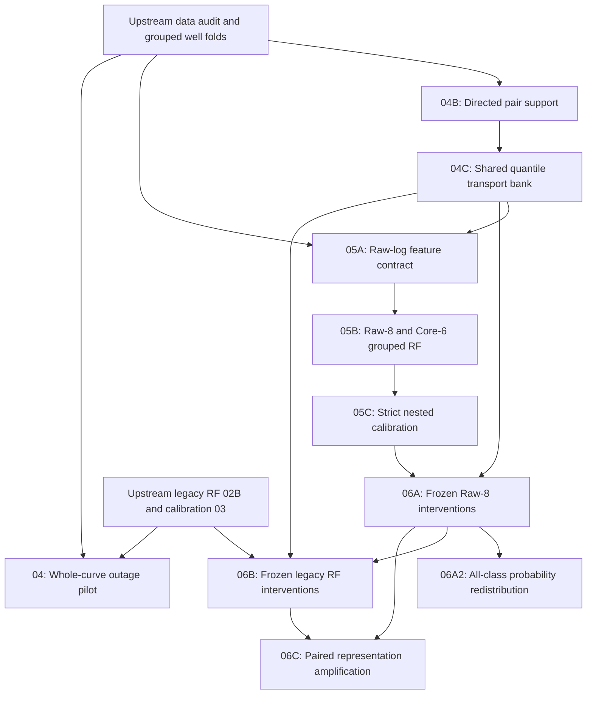

# StrataShift

**Controlled Measurement Interventions, Representation Sensitivity & Robustness**

*A well-aware research framework from intervention eligibility and calibrated classifiers to paired, frozen-model intervention effects and representation amplification.*

> **Scope:** StrataShift uses the FORCE 2020 well-log/lithofacies dataset as a case study. It is an **intervention design, evaluation, and model-diagnostics workflow**, not a claim that a geological causal mechanism has been identified. The notebook results included in this repository are recorded outputs from previous local runs; the repackaged notebooks have not been rerun after their filesystem paths were made portable.

## At a glance

| Component | Scope | Evidence in the committed notebook |
|---|---|---|
| **04 · Whole-curve outage** | Frozen legacy RF; observed log outage, descendant recomputation, negative controls | **Pilot**: fold 1, GR / RHOB / PEF; gates passed |
| **04B · Pair support registry** | Directed source → target lithology and feature support, fold-aware | **Full**: 5,280 directed feature/class/fold candidates; registry gate passed |
| **04C · Shared transport bank** | Empirical CDF / quantile transport with intensity doses | **Full**: 319 selected conditions; transport bank gate passed |
| **05A · Raw-feature contract** | Restrict features to raw logs and freeze preprocessing rules | **Full**: contract gate passed |
| **05B · Raw-log RF** | Raw-8 vs Core-6 under unseen-well grouped 5-fold CV | **Full**: 1,170,511 OOF rows/model, 98 wells; gates passed |
| **05C · Nested calibration** | Strict grouped temperature calibration of raw RF probabilities | **Full**: 20 pairwise auxiliary RF fits; gate passed |
| **06A · Raw-8 interventions** | Frozen, tie-aware class-conditional transport interventions on Raw-8 RF | **Full**: 319 conditions × 4 doses; stage gate passed |
| **06A2 · All-class redistribution** | Track changes across every one of the 12 class probabilities | **Full**: 15,312 class-condition-dose summaries; stage gate passed |
| **06B · Legacy interventions** | Same transport bank applied to frozen engineered-feature RF | **Full**: 319 conditions × 4 doses; structural-zero controls passed |
| **06C · Paired amplification** | Match intervention effects between raw and engineered representations | **Full**: 1,276 paired condition-dose rows and 20,928 paired well rows; gate passed |
| **07A · Robust RF selection** | Strict nested well-grouped selection among regularized/dropout candidate RFs | **Full**: five folds; robust candidate underperformed Raw-8 on some clean-data metrics |

**Why it exists.** Common lithology classifiers use correlated well logs and engineered features. High prediction accuracy does not answer whether model predictions are robust to missing measurements, whether a proposed perturbation is supported by available geology, or whether confidence scores remain reliable. StrataShift separates these questions and preserves a traceable sequence of audits, intervention specifications, baselines, and calibration checks.

## Scientific questions

1. **Outage sensitivity:** What changes when *an entire measured curve* becomes unavailable to a frozen model (instead of retraining it)?
2. **Feasible interventions:** Which directed transitions from one observed lithology-conditioned measurement distribution to another have sufficient training/validation support?
3. **Comparable interventions:** Can a shared intervention bank produce exactly aligned perturbations for comparisons between different classifiers?
4. **Direct vs engineered pathways:** What do minimally processed raw-log RF baselines reveal about the contribution of engineered feature pathways?
5. **Probability reliability:** Do nested, well-grouped temperature estimates improve log loss without leaking information from the evaluation wells?

### What is *not* claimed

- The intervention acts on the **measurement input**, not on the subsurface rock or its geological causes.
- A directed class-conditional transport is a **synthetic distributional intervention**, not a physical transformation of shale into limestone.
- Support thresholds define eligibility for planned tests; they **do not establish causal identifiability**, external validity or statistical power.
- The `04` notebook's saved outage results represent a **pilot**, not a complete five-fold intervention benchmark.
- `04C` produces a **transport bank**, not final model-effect estimates for every stored intervention.

## Workflow map



**Branches and dependencies:** `04` is a separate whole-curve-outage diagnostic (saved **pilot**); `04B → 04C → 05A → 05B → 05C → 06A → 06A2` is the raw-branch progression. `06B` reuses the same `04C` bank and selected `06A` conditions, but evaluates frozen *legacy* RF models from prior work. `06C` requires **full** `06A` and `06B` outputs and performs paired comparisons. This is not a single strict sequential chain: the legacy and raw branches depend on different previously fitted models.

## Repository layout

```text
StrataShift/
├── README.md
├── requirements.txt
├── .gitignore
├── notebooks/
│   ├── interventions/
│   │   ├── 04_FORCE_frozen_RF_whole_curve_outage_intervention_engine.ipynb
│   │   ├── 04B_FORCE_class_pair_support_and_quantile_transport_registry.ipynb
│   │   └── 04C_FORCE_shared_class_conditional_transport_bank.ipynb
│   ├── raw_models/
│       ├── 05A_FORCE_raw_log_feature_contract.ipynb
│       ├── 05B_FORCE_raw_log_RF_grouped_well_CV.ipynb
│       └── 05C_FORCE_raw_RF_strict_nested_temperature_calibration.ipynb
│   ├── intervention_evaluation/
│       ├── 06A_FORCE_raw_RF_class_conditional_transport_interventions_TIE_SAFE.ipynb
│       ├── 06A2_FORCE_all_class_probability_redistribution_MEMORY_TIE_SAFE_FIXED.ipynb
│       ├── 06B_FORCE_legacy_RF_FULL_PRECISION_FIXED.ipynb
│       └── 06C_FORCE_raw_vs_legacy_representation_amplification.ipynb
│   └── robustness/
│       └── 07A_FORCE_robust_RF_nested_grouped_candidate_selection.ipynb
├── data/
│   └── raw/                  # put train.csv here locally; not tracked by Git
├── artifacts/                 # intermediate files/models; not tracked by Git
├── scripts/
│   ├── pre_publish_check.py
│   └── check_inputs.py
└── RELEASE_NOTES.md
```

## Detailed notebook guide

### 04 — Frozen Random Forest: whole-curve outage

**Notebook:** [`04_FORCE_frozen_RF_whole_curve_outage_intervention_engine.ipynb`](notebooks/interventions/04_FORCE_frozen_RF_whole_curve_outage_intervention_engine.ipynb)

Keeps an existing, trained legacy Random Forest **frozen**. It replays baseline predictions for held-out wells, simulates the unavailability of a selected well-log feature across the observed portion of each validation well, applies the specified missing-value treatment and recomputes affected engineered descendants. It measures changes in calibrated/raw log loss, prediction flips, accuracy and well-balanced effects. The notebook includes no-operation replay checks and a structural-zero-path control (PEF, which is inactive in this legacy model's pathway). The saved execution is **pilot mode**, covering fold 1 and GR, RHOB, PEF. In that pilot, the well-balanced change in calibrated log loss was about **+1.2469 for GR**, **+0.0708 for RHOB**, and **0 for PEF**. These are model-response estimates under a specified synthetic outage, not effects on geological lithology.

**Requires:** `train.csv`, well-fold assignment, legacy RF artifact/model and OOF files from stage 02B, nested temperature registry and calibrated OOF outputs from stage 03. The optional causal contract check refers to a stage-01 contract location in the original code; confirm its local placement if you use that optional audit. **Produces:** pilot/full condition summaries, replay and negative-control gates, per-well/per-lithology effects and diagnostic plots.

### 04B — Directed class-pair support and quantile registry

**Notebook:** [`04B_FORCE_class_pair_support_and_quantile_transport_registry.ipynb`](notebooks/interventions/04B_FORCE_class_pair_support_and_quantile_transport_registry.ipynb)

Before transferring one log's distribution across lithology classes, it evaluates **directed** combinations of outer fold, log feature, source class and target class. It summarizes observed rows and wells in relevant training and validation partitions, checks whether empirical quantiles are meaningful, and labels candidate transitions for confirmatory, descriptive or insufficient support. Quantile summaries use only the appropriate **outer-training** data. The recorded **full** run enumerated **5,280** directed combinations and passed its registry gate. **Produces:** support summaries, class quantiles, stability checks, candidate recommendations, policy configuration, and machine-readable stage gate.

### 04C — Shared class-conditional transport bank

**Notebook:** [`04C_FORCE_shared_class_conditional_transport_bank.ipynb`](notebooks/interventions/04C_FORCE_shared_class_conditional_transport_bank.ipynb)

Consumes the **full** 04B gate and registries, cleans the measurements consistently, rechecks eligible class-pair support, and performs empirical percentile-to-percentile transport from a **source** to a **target** lithology-conditioned reference distribution. Four blend intensities are stored: **0.25, 0.50, 0.75, 1.00**. Resistivity `RDEP` is blended in log space where specified. Transport definitions are fitted from outer-training data only; stored per-condition rows can be reused as **the same interventions for different model families**. The recorded full run selected **319** conditions and passed the bank gate. The bank itself is an input to *subsequent* intervention-effect evaluation, not evidence that the perturbations are physically realizable.

### 05A — Raw-log feature and preprocessing contract

**Notebook:** [`05A_FORCE_raw_log_feature_contract.ipynb`](notebooks/raw_models/05A_FORCE_raw_log_feature_contract.ipynb)

Locks a diagnostic raw-feature branch using **GR, NPHI, RHOB, DTC, RDEP, CALI, PEF, SP**. It audits observed values, missingness by class and well, physical plausibility, sentinel handling, fold coverage, redundancy and correlations. It excludes well IDs, measured depth, spatial coordinates, geological context columns, targets and feature-engineered descendants from the *model input*. It specifies **training-fold-only median imputation**, without scaling or explicit missingness indicators. The recorded full-stage contract gate passed. It audits 04C's completion but does not train a classifier itself.

### 05B — Raw-log RF under grouped, unseen-well CV

**Notebook:** [`05B_FORCE_raw_log_RF_grouped_well_CV.ipynb`](notebooks/raw_models/05B_FORCE_raw_log_RF_grouped_well_CV.ipynb)

Trains two comparable Random Forests under the predefined **five grouped outer folds**, keeping wells disjoint between training and validation. **Raw-8** uses all eight logs; **Core-6** excludes PEF and SP. Both share the same RF hyperparameters, including **800 trees**, and each fold fits its median imputer only on the outer-training portion. It saves per-fold models/imputers, out-of-fold probabilities, overall/per-class/per-well metrics, confusion matrices, feature importance and missingness diagnostics. Recorded full OOF performance was **69.60% accuracy / 0.943 log loss** (Raw-8) and **68.33% / 1.030** (Core-6). The stage gate passed. This comparison is diagnostic, not an optimized model leaderboard.

### 05C — Strict nested grouped temperature calibration

**Notebook:** [`05C_FORCE_raw_RF_strict_nested_temperature_calibration.ipynb`](notebooks/raw_models/05C_FORCE_raw_RF_strict_nested_temperature_calibration.ipynb)

Reads the **05B** OOF predictions for both models. For each target outer fold, calibration examples are created using auxiliary models trained **without that target fold and without their own held-out prediction fold**; the collected calibration predictions determine a positive temperature. Its complete run trained **20 auxiliary pairwise RF models** (10 held-out-fold pairs × 2 feature variants), passed its quality gates, and preserved predicted labels and accuracy. For Raw-8, pooled log loss changed from **0.942976 → 0.936114**; for Core-6, **1.029874 → 0.985698**. **Caution:** pooled ECE worsened (Raw-8 **0.027674 → 0.036151**; Core-6 **0.033539 → 0.050557**) and pooled multiclass Brier scores also increased slightly for both variants. Calibration is therefore **metric-dependent**, and must not be presented as uniformly improved.


### 06A — Frozen Raw-8 RF intervention effects

**Notebook:** [`06A_FORCE_raw_RF_class_conditional_transport_interventions_TIE_SAFE.ipynb`](notebooks/intervention_evaluation/06A_FORCE_raw_RF_class_conditional_transport_interventions_TIE_SAFE.ipynb)

Uses the **full 04C shared transport bank** to perturb one observed log at a time on held-out wells, while keeping Raw-8 RF models, per-fold imputers, and nested temperatures fixed. Replays existing OOF controls from `05C`, checks row alignment and near-tied argmax behavior, and computes raw/calibrated log-loss changes, source/target class probability shifts, prediction transitions, well-balanced effects, bootstrap/Wilcoxon-based uncertainty, FDR checks and dose response. Full saved run: **319 directed conditions × 4 doses = 1,276 condition-dose combinations**, across five outer well-group folds; internal stage gate passed. The TIE_SAFE suffix refers to guarding numerical tie behavior under temperature scaling, *not* a new causal identification guarantee.

### 06A2 — All-class probability redistribution

**Notebook:** [`06A2_FORCE_all_class_probability_redistribution_MEMORY_TIE_SAFE_FIXED.ipynb`](notebooks/intervention_evaluation/06A2_FORCE_all_class_probability_redistribution_MEMORY_TIE_SAFE_FIXED.ipynb)

Extends `06A` from source/target outcome measures to the **entire 12-class probability vector** for each selected, depth-aligned intervention. Measures changes to every class's raw/calibrated probability, source–target margins, probability transfer, entropy and aggregate vector shifts; also produces class-level and per-well summaries and plots. Preserves frozen models and guards against both excessive RAM consumption and near-tie artifacts. Recorded full run: **319 conditions**, **1,276 condition-dose combinations** and **15,312 class-level condition-dose summary rows**, with stage gate passed. These are probabilities *assigned by the classifier*, not observed geological conversions.

### 06B — Frozen engineered-feature RF interventions

**Notebook:** [`06B_FORCE_legacy_RF_FULL_PRECISION_FIXED.ipynb`](notebooks/intervention_evaluation/06B_FORCE_legacy_RF_FULL_PRECISION_FIXED.ipynb)

Runs exactly the **same directed class-conditional transport bank** and doses as `06A` on the frozen **legacy engineered-feature RF**, rebuilding downstream engineered-feature values after the log intervention. Retains the earlier model, imputation/scaling and nested temperatures; performs model-replay, feature-order, dependency, and structural-zero-path validation. The full-precision fix puts control/intervention probability calculations on a consistent `float64` footing to avoid artificial ~1e-8 residuals for inactive PEF/SP paths. Recorded full run: **319 conditions**, **1,276 condition-dose combinations**, and **79 structural-zero control conditions** successfully checked; overall stage gate passed. Do not replace this file with the older `FINAL_FIXED` version whose saved structural-zero gate failed.

### 06C — Paired representation amplification

**Notebook:** [`06C_FORCE_raw_vs_legacy_representation_amplification.ipynb`](notebooks/intervention_evaluation/06C_FORCE_raw_vs_legacy_representation_amplification.ipynb)

Loads full `06A` (Raw-8) and `06B` (legacy) summaries, validates exact correspondence of directed conditions, doses and wells, then defines **representation amplification** as the difference in intervention-induced log-loss changes between the engineered-feature and raw-log RFs. Produces condition-dose contrasts, well-balanced feature-dose summaries, fold heterogeneity, dose trends, and structural-exclusion controls. Recorded full run: **1,276 paired condition-dose observations** and **20,928 paired per-well rows**; integrity gates passed. **Interpretation constraint:** differences between two separately fitted models/representations describe a paired *model-response contrast* and do not, on their own, identify the isolated causal effect of feature engineering.

### 07A — Well-grouped robustness candidate selection

**Notebook:** [`07A_FORCE_robust_RF_nested_grouped_candidate_selection.ipynb`](notebooks/robustness/07A_FORCE_robust_RF_nested_grouped_candidate_selection.ipynb)

Assesses whether regularization or training-only, single-log median-replacement augmentation can reduce sensitivity relative to the **05B Raw-8** reference. Four candidate designs are evaluated with grouped inner selection inside each outer well-held-out fold; comparison uses the frozen stage-06C analysis as motivation but does not retrofit outcomes onto test data. Pilot/full modes use different resource budgets, and all preprocessing statistics are learned within their corresponding training splits. **Saved full run:** five outer folds and 80 inner candidate evaluations; the selected approach reached approximately **67.27% accuracy** and **0.9825 log loss**. This is **not a general improvement** over the original Raw-8 baseline (~69.60% accuracy, ~0.943 log loss); publish the trade-off and the negative result transparently. `07B` strict nested calibration and `07R0` intervention-based augmentation are intentionally excluded pending a documented executed run.

## Results snapshot

These values summarize **saved outputs in uploaded notebooks**, not results from a fresh run in the packaged directory.

| Experiment | Metric / audit | Recorded observation |
|---|---|---|
| Whole-curve outage (pilot) | Well-balanced Δ calibrated log loss | GR +1.246900; RHOB +0.070826; PEF 0 |
| Pair registry (full) | Directed feature/class/fold candidates | 5,280; gate passed |
| Shared transport bank (full) | Selected directed conditions | 319; gate passed |
| Raw-log feature contract (full) | Primary input logs | 8; gate passed |
| Raw RF (full) | Raw-8 accuracy / pooled NLL | 0.695989 / 0.942976 |
| Raw RF (full) | Core-6 accuracy / pooled NLL | 0.683319 / 1.029874 |
| Nested calibration (full) | Raw-8 NLL, before → after | 0.942976 → 0.936114 |
| Nested calibration (full) | Core-6 NLL, before → after | 1.029874 → 0.985698 |
| Nested calibration (full) | 15-bin ECE, Raw-8 | 0.027674 → 0.036151 (**worse**) |
| Nested calibration (full) | 15-bin ECE, Core-6 | 0.033539 → 0.050557 (**worse**) |
| Raw-8 transport interventions (full) | Conditions × doses | 319 × 4 = **1,276**; gate passed |
| All-class redistribution (full) | All-class summary rows | 1,276 × 12 = **15,312**; gate passed |
| Legacy transport interventions (full) | Conditions × doses; structural-zero | 319 × 4; **79** inactive-path conditions checked; gate passed |
| Paired representation amplification (full) | Matched condition-dose / per-well rows | **1,276 / 20,928**; gate passed |
| Robust RF selection (full) | Accuracy / log loss | **~67.27% / 0.9825**; worse than raw-8 on these clean metrics |

**Interpretation cautions:** Grouped out-of-fold data address within-well sample dependence better than random row splits, but rare lithology classes can be absent from individual validation folds. Different inclusion criteria may change headline metrics. Never compare model results from differently filtered populations as though they were paired estimates. Stored stage gates validate implemented conditions, not the correctness of every scientific assumption.

## Data provenance and attribution

The underlying case study is the **FORCE 2020 lithofacies / well-log competition dataset**, not distributed in this repository. The original competition material and dataset record are available at:

- [Official competition repository](https://github.com/bolgebrygg/Force-2020-Machine-Learning-competition)
- [Public dataset record and DOI](https://doi.org/10.5281/zenodo.4351156)

The competition identifies raw well logs under the **Norwegian Licence for Open Government Data (NLOD) 2.0** and lithofacies labels under **CC BY 4.0**. Follow the data providers' attribution and redistribution requirements if you download, modify or publish their data.

Suggested dataset attribution, consistent with the competition guidance:

> Lithofacies data was provided by the FORCE Machine Learning competition with well logs and seismic 2020.

See the official repository and Zenodo entry for citation metadata and source conditions. A separate license for **the notebook code** should be selected only by the relevant code owners; no blanket software license is asserted by this package.

## Installation and portability

1. Clone or download this repository. Python **3.10+** with a local Jupyter environment is recommended (not an assurance of execution on every version/OS).
2. Install dependencies:

   ```bash
   python3 -m pip install -r requirements.txt
   ```

3. Put the original **training CSV** at `data/raw/train.csv` (do **not** commit it). The official test file is **not required** by this StrataShift workflow.
4. Reproduce upstream stage outputs or point the notebooks to an existing working `FORCE_Causal_Project` artifacts folder (see below).
5. Start Jupyter/VS Code from anywhere **inside the repository**, and run the relevant notebooks in the order below.

### Configure paths without editing every notebook

Every notebook's path cell (including stage 06) now recognizes:

| Environment variable | Default | Usage |
|---|---|---|
| `STRATASHIFT_REPO_ROOT` | Auto-detected from current working directory | Set if the notebook kernel starts outside the repo |
| `STRATASHIFT_TRAIN_CSV` | `<repo>/data/raw/train.csv` | Training CSV location |
| `STRATASHIFT_ARTIFACT_ROOT` | `<repo>/artifacts` | All upstream/downstream stage files and outputs |

On macOS/Linux, run these commands **before opening VS Code or the Jupyter kernel** if upstream files already exist elsewhere:

```bash
export STRATASHIFT_REPO_ROOT="$HOME/Desktop/StrataShift"
export STRATASHIFT_TRAIN_CSV="$HOME/Desktop/train.csv"
export STRATASHIFT_ARTIFACT_ROOT="$HOME/Desktop/FORCE_Causal_Project"
```

The three variables are optional; use your **real paths**, not these examples. For portable local execution without environment variables, copy/mount the upstream stage outputs into `artifacts/` and the training CSV into `data/raw/`. These locations are intentionally `.gitignore`d.

**Notebook caveat:** Previously recorded display outputs retain their *old-run results* (with personal filesystem prefixes redacted), and are not proof that the rewritten portable paths have been executed successfully. For an exact rerun, capture a new environment lock and verify stage gates after execution.

### Required upstream files and execution order

Several notebooks read intermediate outputs from earlier repositories. For this reason, **publishing the notebooks is self-contained, but reproducing the computation is not**. At minimum, arrange the following inside the chosen `STRATASHIFT_ARTIFACT_ROOT`:

| Stage | Required inputs / dependencies | Run |
|---|---|---|
| `04` | Stage `01` well-fold CSV, stage `02B` legacy RF models and OOF predictions, stage `03` nested temperature registry & calibrated OOF | Pilot by default; optional full |
| `04B` | `train.csv` and `01_clean_splits_support/10_grouped_5fold_well_assignment.csv` | Full (for 04C) |
| `04C` | `04B_class_pair_support_transport_registry/full/` gates, pair registries and configuration | Full |
| `05A` | Full 04C transport bank gate/config + raw Train and well folds | Full |
| `05B` | 05A feature contract, preprocessing policy, gate and file hashes | Full |
| `05C` | 05A gates/hashes, 05B full stage gate/config and both OOF Parquet files | Full |
| `06A` | Full 04C bank/manifest/gate/config; 05A contract; 05B frozen Raw-8 models/gates; 05C calibrated Raw-8 OOF, temperatures/gates; train and folds | **Full** to feed 06A2 and 06B |
| `06A2` | Full 06A selected conditions/gate; 04C bank; frozen 05B/05C Raw-8 controls and temperatures; train and folds | Full |
| `06B` | Full 04C bank; full 06A conditions/gate; upstream 02B legacy models and OOF; upstream 03 nested temperatures and calibrated OOF; train and folds | **Full** to feed 06C |
| `06C` | Full 06A and 06B `05_condition_dose_effect_summary.csv`, `06_all_per_well_effects.csv`, stage gates and run configs | Full |
| `07A` | Stage 01 grouped well folds; 05A feature contract; 05B full Raw-8 OOF and gates; 06C full gate/config | Full |

The precise filenames and input checks are encoded in each notebook's configuration cell. Use the helper to inspect prerequisites:

```bash
python3 scripts/check_inputs.py
```

Run this order for the main chain:

```text
04B (full) → 04C (full) → 05A (full) → 05B (full) → 05C (full)
                                               ↓
                                            06A (full) → 06A2 (full)
                                               ↓
                              legacy 02B + 03 → 06B (full)
                                               ↓
                                            06C (full)
```

The `04` outage pilot can be executed separately once the legacy RF and calibration artifacts from earlier work are available. The diagram is a dependency guide, not an instruction to retrain any frozen classifier during intervention evaluation. An upstream dependency may legitimately require substantial CPU, memory and disk storage; **this ZIP intentionally omits model weights, CSV/Parquet data, generated transport banks and figures**.

## Quality assurance and model design

- **No official-test optimization:** stage-05 full results explicitly mark the official test unused.
- **Unseen-well evaluation:** validation partitions are groups of wells, not individual sampled rows.
- **Training-only transforms:** raw-log missing-value medians are fitted separately within each training fold.
- **Nested calibration:** the target outer fold and auxiliary inner-held-out fold are excluded from the auxiliary fitting data.
- **Negative controls:** outage runs include no-op replay and inactive-path controls.
- **Input contracts and gates:** stages record metadata checks, file hashes, conditions and passes for their implemented invariants.
- **Output integrity:** this archive retains embedded notebook figures/tables for review; a prepublication checker flags accidental data files or local paths.

## Limitations and planned extensions

1. The saved whole-curve outage analysis covers only a **pilot**. Further five-fold analyses and uncertainty estimates are needed before definitive cross-well conclusions.
2. Quantile-transport eligibility is a **data-support assessment**; physical feasibility, distribution shift and extrapolation still require scrutiny.
3. Class-specific claims for rare lithologies need explicit caveats about supporting wells, folds and missingness.
4. Pooled sample metrics may be dominated by wells with more measurements; report per-well summaries and uncertainty where possible.
5. The **transport bank alone** is not a measured intervention effect; stages 06A, 06B and 06C evaluate the resulting classifier responses. The interventions remain synthetic and must not be interpreted as physical lithology changes.
6. Calibrated NLL may improve while ECE/Brier worsens; report all metrics and avoid single-metric narratives.
7. Differences between Raw-8 and Legacy include more than just feature transformations (e.g., separately fitted models); interpret amplification as a controlled, paired prediction-response comparison rather than a uniquely identified causal effect of engineering.
8. Stored notebooks include historical output and code but deliberately omit large upstream data/artifacts. Obtain the source data and rerun with the same fold contract for numerical reproduction. The path-only revisions to notebooks have not been rerun.

## Previewing and publishing

Run the optional publication check:

```bash
python3 scripts/pre_publish_check.py
```

The script checks that all **eleven** notebooks exist and are valid JSON, warns if their embedded outputs or file sizes are large, scans code and saved output text for common local paths, and verifies the raw data/output directories are excluded by `.gitignore`. Its output is an **audit aid**, not a security guarantee.

A typical first GitHub release is:

```bash
git init -b main
git add README.md RELEASE_NOTES.md requirements.txt .gitignore notebooks/ scripts/ data/raw/.gitkeep artifacts/.gitkeep
git diff --cached --name-only
git commit -m "Initial release: StrataShift measurement intervention framework"
git remote add origin https://github.com/YOUR_USERNAME/StrataShift.git
git push -u origin main
```

Create the corresponding **empty** public repository on GitHub first (do not auto-add README or `.gitignore`). Replace `YOUR_USERNAME`; do not paste credentials into the repository.

## How to cite

For the **underlying dataset**, cite the official FORCE 2020 competition dataset ([DOI](https://doi.org/10.5281/zenodo.4351156)) and comply with its attribution guidance. For **this code**, link to this GitHub repository and the specific commit or release used in your analysis; add named authors and a software citation file once authorship and publication details have been confirmed.

---

*StrataShift is a research prototype focused on traceable measurement interventions and reliable evaluation. It is not a geological simulation engine and does not imply lithology can be changed by altering measurements.*

## Publishing policy for this release

- The eleven selected notebooks retain their executable **code cells and stored outputs**. Markdown cells containing Persian explanatory text were removed at the author's request; original scientific explanations are consolidated in this README.
- Path-only edits use `STRATASHIFT_REPO_ROOT`, `STRATASHIFT_TRAIN_CSV`, and `STRATASHIFT_ARTIFACT_ROOT`. See the setup instructions; setting `STRATASHIFT_ARTIFACT_ROOT` to your existing shared experimental artifact directory is recommended.
- **No notebook was re-executed after packaging.** The saved results are historical results from the supplied local notebooks and should not be represented as a fresh post-edit run.
- Stage `07A` is complete, but `07B`/`07R0` have been intentionally omitted from the main branch because confirmed full experimental outputs are not available.
